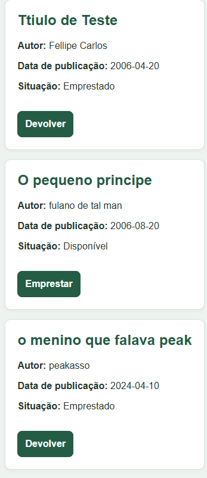
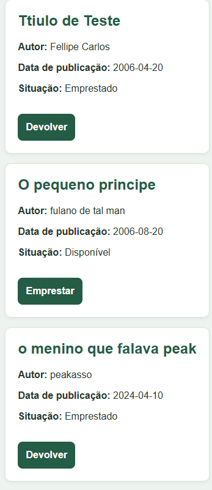
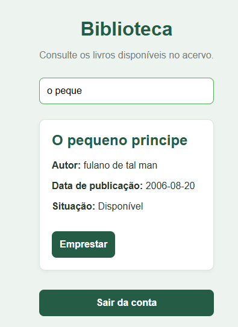

# testes de funcionalidade

• Teste 01 — Funcionalidade: criação de conta

• Entrada/ação:  colocar email e senha

• Resultado esperado:  conta criada e acessar o site

• Resultado obtido: conta criada com sucesso e acesso permitido para o tipo de conta leitor e escritor 

• Situação: passou 

• Teste 02 — Funcionalidade: empresta e devolver livro

• Entrada/ação:  clicar no botão referente ao livro

• Resultado esperado:  ao clicar em emprestar, o botão muda para devolver e o status para emprestado

• Resultado obtido: livro emprestado e devolvido

• Situação: passou 

evidencias:  e 

• Teste 03 — Funcionalidade:  barra de pesquisa

• Entrada/ação:  escrever o nome do livro

• Resultado esperado:  aparecer o livro cujo nome foi escrito na barra de pesquisa

• Resultado obtido: livro encontrado

• Situação: passou

evidencia: 

# Plano alternativo

plano de apresentação alternativo, em caso de o site não funcionar, será utilizado de imagens comprovando o funcionamento do site em um arquivo de slide-show 

